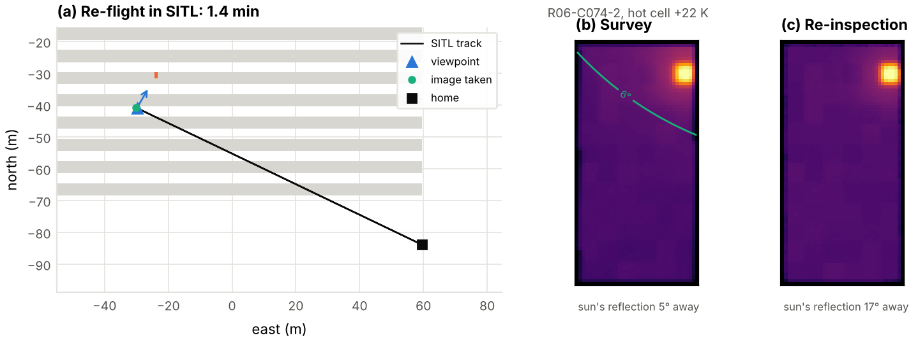
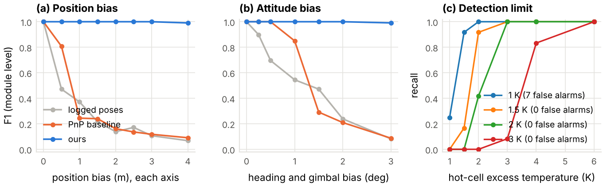
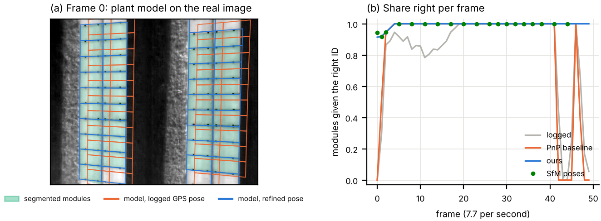

# pv-thermal-defect-mapper

**From drone thermal images to the exact solar modules, and cells, that need fixing.** It finds
hot cells, failed bypass diodes and offline modules or strings in the thermal frames. It then
uses the camera pose of each image and the plant layout from the flight plan to name the module
behind every finding, without stitching a mosaic.

This is the second half of a pair:

| | Repo | Job |
|---|---|---|
| 1 | [pv-drone-inspection-planner](https://github.com/Mohammedgmail/pv-drone-inspection-planner) | Plans when to fly and where to point the camera (irradiance window, resolution, sun glare). Exports ArduPilot missions and `mission.json`: the plant layout with module IDs, plus the predicted pose of every image. |
| 2 | **pv-thermal-defect-mapper** (this repo) | Reads the frames and that `mission.json`. Finds the defects and maps each one to a module and cell, correcting the camera poses from the images first if they are not RTK-grade. |

[](https://github.com/Mohammedgmail/pv-thermal-defect-mapper/actions/workflows/ci.yml)


## Why

A hot spot in pixel (412, 230) of image 3,187 is no use to a technician. A list that says
"row 4, module 22, lower level, cell (1, 0), +6.8 K" is. The usual route is to stitch the
thermal images into an orthomosaic and draw the modules on it. That is hard on solar plants:
the images are low-resolution, low-contrast and made of thousands of identical modules, so
feature matching has little to hold on to.

The flight planner already knows the plant geometry and where every image was meant to be
taken. So each pixel can be traced straight back onto a module. Two things get in the way:

- **The camera pose is never exact.** A drone without RTK logs its position to a metre or two,
  about one module width (1.13 m). Heading and gimbal errors of a few tenths of a degree move
  the image by 10–20 cm at 30 m, about one cell (18 cm).
- **The glass is a mirror.** The sun's reflection in a thermal image looks like a hot spot.

## How it works

1. **Rectify.** For each frame, every module of the rows its pass was planned for is projected
   into the image and resampled into a 3 cm grid in module coordinates. Pixels where another
   row blocks the view are masked.
2. **Analyse each module crop.**
   - Hot spot: connected pixels at least 3 K above the module median and at least a quarter of
     a cell in size, located to the cell by their local peaks.
   - Bypass-diode substring: one third of the module (two cell columns, full length) at least
     2 K warmer than the other two, and by at least 1.5 times the difference between those two.
   - Offline module: the whole module at least 2 K warmer than its row neighbours in the same
     frame.
3. **Glare guard.** A hot spot is dropped if the line of sight, mirrored in the glass, points
   within 6° of the sun. The sun position comes from pvlib at the image's timestamp.
4. **Fuse the views.** Each module appears in about three frames. A finding is kept only if
   most of its views agree, with at least two views. For a hot cell, the cell must recur in at
   least half of the views. Three or more neighbouring offline modules become one offline
   string.
5. **Pose refinement** (`--refine`). This uses the plant itself as the calibration target. Each
   frame is resampled onto the plane of its row, where the layout is known exactly. Then:
   - the lower table edge (warm modules against cooler ground) gives the offset across the row;
   - the spacing of the cool aluminium frame lines along the row gives the true distance to the
     module plane, which fixes height errors;
   - the frame lines, modulo one module width, give the fine offset along the row;
   - which module is which is decided once for the whole pass. The row ends anchor it: a drop
     to ground temperature, or, where sunlit ground is as warm as the modules, the point where
     the frame lines stop. Consecutive frames are linked by correlating the modules' own
     thermal texture (cells, clamps, soiling) where they overlap. A dynamic programme weighs
     both, so a sudden GNSS jump between two frames, or one wrong row-end reading, does not
     put a frame on the neighbouring module.

   The correction is applied as a camera shift. The table edge is looked for within 2.5 m of
   where the log puts it, then up to half the distance to the next row; if it is still not
   found, the logged poses are kept and the report says so. Thresholds are relative to each frame's
   own contrast, so the same code runs on frames in kelvin and on raw camera counts.
6. **Re-inspection** (`--reinspect`). Modules the survey could not settle (a hot spot dropped
   as a reflection in some views, views that disagree, or too few views) get a second look: a
   viewpoint per module that meets the resolution and viewing-angle limits with the sun's
   reflection at least 15° away at the time of the re-flight, a short tour through them, and an
   ArduPilot mission (`reinspect.waypoints`) that holds the gimbal and takes one image at each.
7. **Outputs:**
   - `findings.csv`;
   - `findings.geojson`: module outlines in WGS84, ready for QGIS or a web map;
   - `report.md`: findings ranked by urgency, offline strings first;
   - `gallery.png`: the rectified crop of each finding, with the flagged cells boxed.

   [`examples/june-noon/results/`](examples/june-noon/results/) shows all four for the
   example plant.

## Results

There is no public dataset of whole drone thermal surveys with camera poses and module-level
ground truth. So the pipeline is tested on a **thermal digital twin** that renders the planned
flight itself, and the localisation is then checked on a short real flight (section 6). The twin
ray-casts every pixel into the plant and models:

- module temperature from clear-sky irradiance, air temperature and wind (pvlib Faiman model);
- cell-to-cell scatter, optional junction-box and edge patterns, and cooler, low-emissivity
  frames;
- sunlit and shaded ground;
- the sun's reflection;
- emissivity loss at grazing angles;
- lens and motion blur, vignetting, and 50 mK sensor noise;
- soiling as a nuisance that is rendered but never counted as a defect.

Every result can be reproduced with `python docs/run_experiments.py --fresh` (about 6 hours on
two cores; rendered flights are cached between experiments).

The images are rendered from the *flown* poses: the plan plus a 3 cm, 0.2° tracking error, in
line with what repo 1 measured in ArduPilot SITL. The mapper only gets the *logged* poses, which add
GNSS and gimbal errors.

The test plant is repo 1's example: 4,200 modules in 20 rows, Northumberland, 21 June, flown
with its noon plan (500 frames, two batteries). 44 modules are defective:

- 16 single hot cells (6–25 K);
- 6 multi-cell hot spots;
- 8 bypass-diode substrings (3.5–8 K);
- 6 offline modules;
- one offline string of 8 modules.

### 1. Camera pose errors, and fixing them from the image

Each error model was flown ten times with independent random errors, and the whole plant was
mapped with the logged poses, with a PnP baseline (the camera pose fitted to the module-corner
grid, as in model-based tracking) and with `--refine`.

| Logged camera poses | Method | F1 (mean, 95% interval) | Flights with F1 = 1 | False alarms | Hot cell on the exact cell | Pose error at the modules |
|---|---|--:|--:|--:|--:|--:|
| Exact (reference) | | 1.00 | | 0 | 100% | 0 |
| RTK: 2 cm, heading 0.3°, gimbal 0.2° | logged | 0.89 [0.87, 0.92] | 0/10 | 8.9 | 25% | 18 cm |
| | PnP baseline | 1.00 | 10/10 | 0 | 92% | 4.2 cm |
| | **ours** | **1.00** | **10/10** | **0** | **100%** | **1.0 cm** |
| RTK position, heading and gimbal off by 1° | logged | 0.58 [0.50, 0.66] | 0/10 | 36.5 | 2% | 59 cm |
| | PnP baseline | 0.78 [0.66, 0.89] | 1/10 | 9.5 | 55% | 31 cm |
| | **ours** | **0.99** [0.98, 1.00] | 5/10 | 0.4 | **94%** | 3.4 cm |
| GNSS without RTK: 1.5 m bias | logged | 0.11 [0.06, 0.18] | 0/10 | 163 | 0% | 2.5 m |
| | PnP baseline | 0.09 [0.04, 0.14] | 0/10 | 227 | 0% | 2.6 m |
| | **ours** | **0.89** [0.70, 1.00] | **8/10** | 2.3 | **99%** | 1.6 cm |

F1 is at module level: a finding on the neighbour of a defective module counts as one false
alarm and one miss. The pose error is the median over flights of the median distance on the
module plane between where the estimated and the true pose put the same pixel.

- **RTK alone is not enough for cell-level results.** A few tenths of a degree of heading or
  gimbal error moves the image by about one cell. With raw RTK poses, only a quarter of hot
  cells land on the right cell, and defects near a module edge spill onto the neighbour.
- **PnP is as good at module level when errors are small**, but it matches each corner to its
  neighbour once the image is off by much of a module, and fails without RTK.
- **Refinement recovers all three cases.** With RTK every flight is perfect and every hot cell
  is on the exact cell. Without RTK, 8 of 10 flights are perfect. In the other two the error was
  beyond what the refinement searches: a 5.9 m height error (a 2.6σ draw of the simulated
  2.25 m vertical error) moved the image across the row by more than the row spacing, and in
  another flight three passes stayed out of reach. The refinement kept the logged poses of those
  passes and the report says so, instead of locking onto a neighbouring row. A barometric or
  RTK height would remove this case.
- Refinement takes about 0.5 s per frame on one CPU core; mapping takes about 0.05 s per frame.


### 2. Sun reflections: why the planner's glare margin matters

Repo 1 re-plans the camera placement for the time of day so that the sun's reflection stays at
least 15° from the line of sight. Here its 09:32 plan (steep camera, two rows per pass) is
flown at 13:00 instead. The reflection then comes within 4° of the line of sight. Poses are
exact in this test, to isolate the effect of the reflection.

| False alarms (healthy modules reported) | Morning plan at 13:00, all images (~3 views per module) | Morning plan at 13:00, every 2nd image (1–2 views) | Noon plan at 13:00, either |
|---|--:|--:|--:|
| Single image, no guard | 665 | 335 | 0 |
| Multi-view fusion | 0 | 323 | 0 |
| Glare guard | 0 | 0 | 0 |
| Fusion + glare guard (default) | **0** | **0** | **0** |

All 44 defects are found in every case but one: with half the images, fusion plus the guard
misses one hot cell. In that case the guard dropped the real hot spot in one of its two views,
because it sat under the reflection. The re-inspection flight (next section) brings it back.

- **The reflection follows the drone.** It lands on different modules in each frame, so
  requiring two agreeing views removes it when every module is seen about three times.
- **With less overlap, fusion fails.** A module seen once is reported on one view, so the
  physics-based guard is what removes the false alarms.
- **The noon plan avoids the problem.** Repo 1 planned it with its own glare margin (at least
  16°), so the reflection never enters a frame and no method reports a false alarm.


### 3. Closing the loop: re-inspection

`--reinspect` turns what the survey could not settle into a second, short flight. For the
morning plan flown at 13:00 with every second image, one module is left uncertain: its hot cell
was flagged in one view and dropped as a reflection in the other. The planner puts a viewpoint
13 m in front of it at 2 cm/px, with the sun's reflection at least 17° away over the whole
module at the time of the re-flight, and writes an ArduPilot mission. Mapping that one image
with the survey's views recovers the hot cell (F1 0.989 → 1.000).

| Survey | Uncertain modules | Re-flight, planned | Flown in SITL | Images within 0.3 m of the viewpoint | F1 before → after |
|---|--:|--:|--:|--:|--:|
| Noon plan, all images | 0 | none | | | 1.000 |
| Morning plan at 13:00, all images | 2 (views disagree) | 1.97 min | 1.82 min | 2 / 2 | 1.000 → 1.000 |
| Morning plan at 13:00, every 2nd image | 1 (masked by glare) | 1.41 min | 1.38 min | 1 / 1 | 0.989 → **1.000** |

The missions were flown in ArduCopter 4.7 SITL with
[`docs/fly_reinspection_sitl.py`](docs/fly_reinspection_sitl.py). Flying them showed that
ArduCopter ignores `DO_DIGICAM_CONTROL` in a mission; the export now uses
`IMAGE_START_CAPTURE`.



### 4. Where it breaks

On the six flight lines with the most defects (150 frames), the logged poses get a fixed bias
of growing size, two flights per step; the images get harder in other runs.

| Condition | Logged poses | PnP baseline | Ours |
|---|--:|--:|--:|
| Position bias with F1 ≥ 0.95, each axis | 0 m | 0 m | **4 m** (largest tested) |
| Heading and gimbal bias with F1 ≥ 0.95 | 0° | 0.5° | **3°** (largest tested) |
| Hot cell on the exact cell, 1° attitude bias | 0% | 18% | 92% |

- **Position.** Refinement stays at F1 0.99–1.00 up to 4 m, with poses within 1 cm (3.6 cm at
  4 m). The PnP baseline matches each module corner to its neighbour as soon as the error is
  over about half a module, and settles a module or more away.
- **Attitude.** Module IDs stay right up to 3°, but a camera shift cannot absorb all of a large
  rotation: cells are exact up to about 1°, and only 0–33% at 2–3°.
- **No row end in view.** Passes that never see a row end keep the along-row error modulo one
  module: fine at 0.5 m, F1 0.31 at 1.5 m. That is the one case that still needs RTK (or a
  pass extended to the row end).
- **Images.** Faint frame lines (1.5 K instead of 6 K), sensor noise up to 0.4 K and flying 4×
  faster than planned (motion blur) all keep F1 1.00 after refinement; at 0.5 K frame-line
  contrast it drops to 0.82–0.98.
- **Detection limit.** With clean modules, a 1.5 K threshold finds 92% of 2 K hot cells with no
  false alarms; the default 3 K finds 83% of 4 K and all 6 K hot cells. Rough modules (1 K cell
  scatter, 2 K junction-box patch) give 168 false alarms at 3 K and need a 4 K threshold.
- **Soiling** is reported as hot spots: 24 of 30 soiled modules were flagged. Temperature alone
  cannot tell them apart; the same showed up in the real crops below.



### 5. Other plants

Three more plants (repo 1's example sites: synthetic layouts at real locations, each planned
for 12:30 local time on 20 March, 15 December and 21 December) were mapped with the same code,
three flights per error model:

| Plant | Layout | Facing | Rows per pass | Frames | F1, RTK: logged / PnP / ours | F1, GNSS: logged / PnP / ours |
|---|---|--:|--:|--:|--:|--:|
| Seville, 37° N | 2P portrait, 6 m row pitch | south | 2 | 184 | 0.94 / 1.00 / **1.00** | 0.19 / 0.18 / **1.00** |
| Gujarat, 23° N | 4L landscape | south | 1 | 352 | 0.93 / 0.79 / **1.00** | 0.06 / 0.15 / **1.00** |
| Queensland, 27° S | 2P portrait | north | 2 | 161 | 0.99 / 1.00 / **1.00** | 0.36 / 0.39 / **1.00** |

Hot cells land on the exact cell in 94–100% of cases after refinement. On the two plants with
two rows per pass, the second row gets its own small correction.

### 6. A real flight: right module IDs from consumer GPS

[PV Hawk](https://github.com/LukasBommes/PV-Hawk) (Bommes et al., *Progress in Photovoltaics*
2022, MIT licence) ships a short real flight with its tests: 50 radiometric frames (640×512,
7.7 per second) over two 2P rows near Erlangen, with a consumer GPS track (quantised, no
altitude, no attitude log), the camera calibration, every module outlined by their
segmentation network and tracked across frames, and a structure-from-motion reconstruction.
[`docs/real_pvhawk.py`](docs/real_pvhawk.py) runs this repo on it:

- **Plant model:** two straight rows fitted to PV Hawk's georeferenced modules, as a design
  layout would give them.
- **Logged poses:** what a drone without a gimbal log knows: GPS position, a nominal 20 m
  flight height, a nadir camera and the heading of the flight line.
- **Ground truth, independent of every pose:** each of the 1,639 segmented module outlines in
  the 50 frames, with its module ID counted from the row end.

| Poses | Module outlines given the right ID | Frames all right | Corner error |
|---|--:|--:|--:|
| Logged GPS | 85.1% | 24 / 50 | 20.8 px |
| PnP baseline | 88.6% | 39 / 50 | 15.6 px |
| Ours without row ends, or without texture links | 95.4% | 46 / 50 | 3.2 px |
| **Ours** | **99.5%** | **46 / 50** | **3.2 px** |
| PV Hawk's SfM poses (reference, 19 frames) | 98.9% | 16 / 19 | |

- The GPS is quantised to about 0.7 m and interpolated, so its error jumps by up to 0.8 m
  between consecutive frames. Interpolating the row-end anchors along the pass cannot follow
  that; the texture links between frames can.
- At the row end, sunlit ground is almost as warm as the modules, so there is no drop in
  temperature to find. The frame lines stopping is what marks the end.
- The 9 remaining misses are in the first four frames, at the far end of the mapped modules.
- The true flight height was about 19.4 m. Any nominal height from 18 to 20 m gives the same
  result; 17 m gives 97.4% and 22 m 79.9%. At 23 m the scale is outside the ±15% the
  refinement searches, and it fails.

This real flight was not used to tune the twin experiments: it led to the relative edge
threshold, the frame-line row ends and the texture links, and all experiments were re-run
after those changes. It is one short flight with a nadir camera, so it shows that the
localisation carries over to real images and real GNSS, not how often it does.



### 7. Real thermal crops

The module analyser was also run on real data: the
[Raptor Maps InfraredSolarModules](https://github.com/RaptorMaps/InfraredSolarModules) dataset
(MIT licence). It has 20,000 module crops from operating plants, 24×40 px each, labelled into
12 classes. The crops are 8-bit and contrast-stretched per image, with no temperatures and no
poses. So only steps 2 and 3 apply, with thresholds in robust standard deviations instead of
kelvin (`relative=True`). Offline modules need row neighbours and are not tested.

With the default thresholds (3σ for hot spots, 2σ for substrings):

| Class (images) | Flagged as hot spot | Flagged as substring | Not flagged |
|---|--:|--:|--:|
| Cell: single hot cell (1,877) | **59%** | 1% | 40% |
| Cell-Multi (1,288) | **69%** | 3% | 27% |
| Diode: one substring (1,499) | 5% | **66%** | 29% |
| Diode-Multi: two substrings (175) | 3% | 13% | 84% |
| Hot-Spot, thin-film modules (249) | 13% | 1% | 86% |
| No-Anomaly (10,000) | 6.8% | 0.5% | **92.8%** |

- **Hot cells:** at 4σ the false-alarm rate on healthy modules falls to 1.3%, and 45% of
  single hot cells and 59% of multi-cell cases are still flagged.
- **Diodes:** the substring test flags 66% of diode faults at 0.5% false alarms.
- **Where it fails:**
  - two warm substrings break the one-third pattern the test looks for;
  - thin-film hot spots are faint;
  - cracking, soiling and vegetation are flagged as hot spots (75%, 71% and 55%), because
    temperature alone cannot tell them apart.

Radiometric frames in kelvin, several views per module and an RGB image would help with all of
these. Use `--relative --hot-k 4` for images without temperatures.


## Quick start

This works on macOS, Linux and Windows with Python 3.10–3.13. On a Mac, run
`brew install python@3.12` first if `python3 --version` shows 3.9.

```bash
git clone https://github.com/Mohammedgmail/pv-thermal-defect-mapper.git
cd pv-thermal-defect-mapper
python3.12 -m venv .venv && source .venv/bin/activate
pip install -e ".[dev]"        # also installs pvmission from pv-drone-inspection-planner
pytest                         # 54 tests, about 4 minutes

# render two passes of the noon plan with non-RTK GNSS errors (under a minute)
pvdefect simulate examples/june-noon/mission.json --lines 3,4 --errors gnss --out survey

pvdefect map survey --mission examples/june-noon/mission.json --out results-raw
pvdefect map survey --mission examples/june-noon/mission.json --out results --refine
```

With the logged GNSS poses, this two-pass survey scores F1 0.32: 3 of 5 defects found, plus 11
false alarms, mostly on their neighbours. With `--refine` it scores F1 1.00, with every hot cell on the
right cell. Open `results/report.md` and `results/gallery.png` to see them.

Other commands:

```bash
pvdefect simulate examples/june-noon/mission.json --out survey      # the whole plant, 500 frames
pvdefect simulate examples/june-morning/mission.json --start 13:00   # a plan flown at the wrong time
pvdefect raptor path/to/InfraredSolarModules                         # the real-crop check
python docs/real_pvhawk.py PV-Hawk/tests/integration/data            # the real-flight check
python docs/run_experiments.py --fresh                               # every simulation result
python docs/paper_figures.py                                         # paper figures, tables, numbers
python docs/make_figures.py --raptor path/to/InfraredSolarModules     # the README figures
```

## Using your own flights

`pvdefect map` needs two things:

- the `mission.json` the flight was planned with;
- a folder with a `frames.json`. The simulator writes one, and it is easy to produce from a real
  flight log:

```json
{"format": "pvdefect-frames/1", "units": "centikelvin",
 "frames": [{"file": "frames/00075.tiff", "line": 3, "seq": 75,
             "time": "2026-06-21T13:03:19+01:00", "enu": [-64.08, -68.0, 21.5],
             "yaw_deg": 0.0, "gimbal_pitch_deg": -41.0}]}
```

- `enu` is metres east, north and up from the plant reference point in `mission.json`. Up is
  height above ground.
- `line` is the pass the image belongs to, and `seq` its number in the plan.
- Images can be 16-bit radiometric TIFF or PNG in centikelvin, or float in kelvin or °C.

DJI's R-JPEG files must first be converted to temperatures with the DJI Thermal SDK, which is
not included.

## Limitations

- **Most numbers are from a simulation.** The twin's thermal and optical parameters are
  plausible round values, not a calibrated camera. Compared with the real flight, its module
  interiors are smoother (temperature spread 0.25 K against about 0.65 K, relative to the step
  from ground to modules about 6 times less) while its frame lines are about as distinct. Real
  images also add soiling, shading, bird droppings, back-sheet patterns and reflections of the
  sky and nearby objects.
- **The real-flight check is one short flight** (50 frames, two rows, nadir camera, consumer
  GPS). It shows that the localisation works on real images and real GNSS errors; it is not a
  measurement of how often it does. A flight with a gimbal log and RTK ground truth would be the
  next test.
- **The analyser uses temperature only.** It cannot tell a hot spot from soiling or cracking
  (24 of 30 soiled modules flagged in the twin; 55–75% of soiling, cracking and vegetation crops
  in the Raptor data), and rough modules need a higher threshold, which costs weak defects.
- **Pose refinement assumes regular fixed-tilt rows with ground visible beside the table.** It
  corrects errors across the row up to half the row spacing (2.9 m on the example plant) and
  ±15% in distance to the module plane; beyond that it keeps the logged poses and reports it. Passes that never see a row end keep any
  along-row error modulo one module (RTK, or a pass extended to the row end, fixes that).
  Attitude errors above about 1.5° leave module IDs right but cells wrong.
- **The glare guard can hide a real defect sitting under the reflection.** Plan flights so the
  reflection stays out of the image, as repo 1 does, or let `--reinspect` take a second look.
- **Offline detection compares a module with its neighbours in the same frame,** so a whole row
  that is warmer than normal is not flagged.
- **Defect classes follow the IEC TS 62446-3 categories only loosely.** There is no severity
  grading by irradiance-normalised temperature difference yet.

## Project layout

```
src/pvdefect/
  scene.py       # plant, modules, camera and image poses from mission.json
  camera.py      # pinhole projection and pixel rays
  simulate.py    # thermal digital twin, defects, nuisances, pose error models, survey writer
  mapper.py      # module crops, hot spots, substrings, offline modules, glare guard, fusion
  refine.py      # pose refinement: table edges, frame lines, row ends, texture links
  baseline.py    # PnP baseline: pose fitted to the module-corner grid
  errormodel.py  # first-order model of pose error to wrong cell and wrong module
  reinspect.py   # uncertain modules, glare-free viewpoints, tour, ArduPilot mission
  evaluate.py    # scoring against the twin's ground truth, rendered surveys
  realdata.py    # check on Raptor Maps InfraredSolarModules
  report.py      # CSV, GeoJSON, gallery and Markdown report
  cli.py         # pvdefect simulate / map / raptor
examples/        # repo 1's missions (noon, morning, three more sites) and example results
docs/
  run_experiments.py      # every simulation result (docs/results/*.json)
  real_pvhawk.py          # the real-flight check
  fly_reinspection_sitl.py
  paper_figures.py        # figures, tables and numbers.tex for the paper (docs/paper/)
  make_figures.py         # the README figures
tests/           # pytest suite
```

## Credits

- [pvlib python](https://github.com/pvlib/pvlib-python): solar position, clear-sky irradiance
  and the Faiman module temperature model (K. S. Anderson et al., *JOSS* 8(92), 5994, 2023).
- [Raptor Maps InfraredSolarModules](https://github.com/RaptorMaps/InfraredSolarModules) (MIT):
  M. Millendorf, E. Obropta and N. Vadhavkar, *Infrared Solar Module Dataset for Anomaly
  Detection*, ICLR 2020 AI for Earth Sciences workshop. The dataset is not included here.
- [PV Hawk](https://github.com/LukasBommes/PV-Hawk) (MIT): the real flight used in Results 6
  comes from its test data. L. Bommes et al., *Georeferencing of photovoltaic modules from
  aerial infrared videos using structure-from-motion*, Progress in Photovoltaics 30(9),
  1122–1135, 2022. The data is not included here.
- Camera data comes from DJI's
  [Zenmuse H20 series specifications](https://enterprise.dji.com/zenmuse-h20-series/specs).
- The flight plans, plant model and SITL tracking errors come from my
  [pv-drone-inspection-planner](https://github.com/Mohammedgmail/pv-drone-inspection-planner).
  Building this repo also found a bug there: rows of the same pass could hide each other. It is
  fixed in v0.1.1.

## Author

**Mohammed Alfandi** · MSc Robotics & AI, Newcastle University ·
[LinkedIn](https://linkedin.com/in/mohammed-alfandi/) · [ResearchGate](https://researchgate.net/profile/Mohammed-Alfandi/)

Released under the [MIT License](LICENSE).
