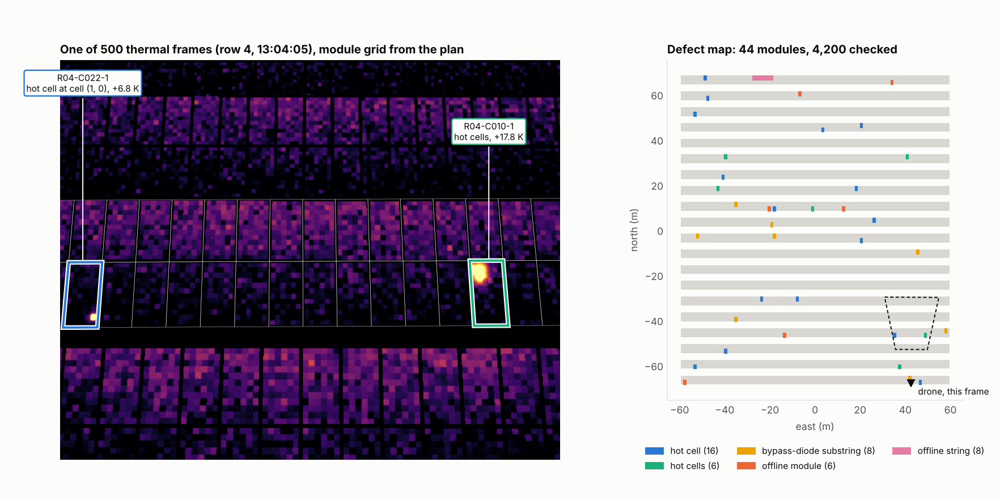
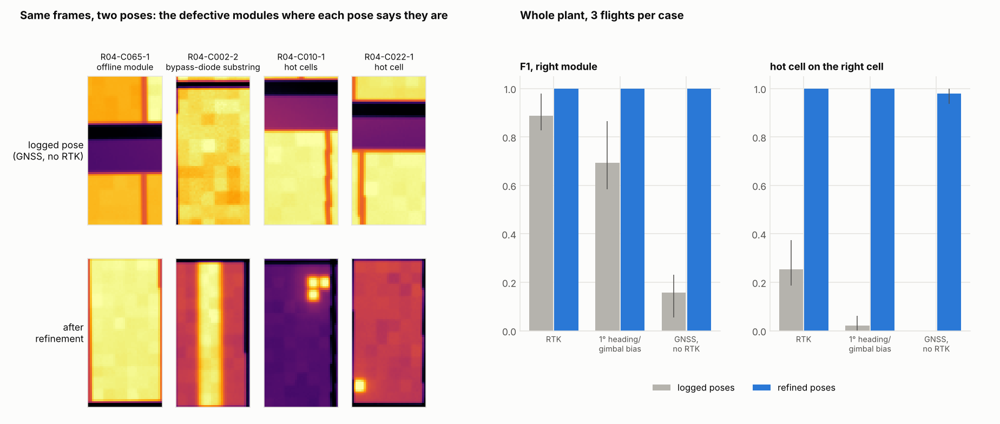
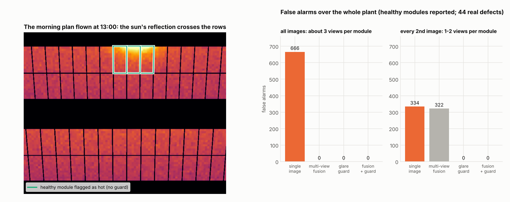
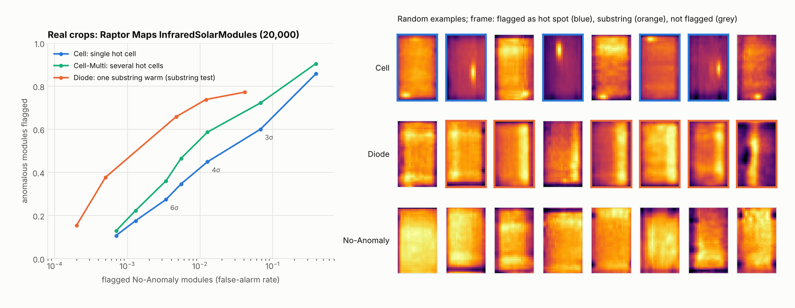

# pv-thermal-defect-mapper

**From drone thermal images to the exact solar modules, and cells, that need fixing.** It finds
hot cells, failed bypass diodes and offline modules or strings in the thermal frames. It then
uses the camera pose of each image and the plant layout from the flight plan to name the module
behind every finding, without stitching a mosaic.

This is the second half of a pair:

| | Repo | Job |
|---|---|---|
| 1 | [pv-drone-inspection-planner](https://github.com/Mohammedgmail/pv-drone-inspection-planner) | Plans when to fly and where to point the camera (irradiance window, resolution, sun glare). Exports ArduPilot missions and `mission.json`: the plant layout with module IDs, plus the predicted pose of every image. |
| 2 | **pv-thermal-defect-mapper** (this repo) | Reads the frames and that `mission.json`. Finds the defects and maps each one to a module and cell, correcting the camera poses from the images first if they are not RTK-grade. |

[](https://github.com/Mohammedgmail/pv-thermal-defect-mapper/actions/workflows/ci.yml)




## Why

A hot spot in pixel (412, 230) of image 3,187 is no use to a technician. A list that says
"row 4, module 22, lower level, cell (1, 0), +6.8 K" is. The usual route is to stitch the
thermal images into an orthomosaic and draw the modules on it. That is hard on solar plants:
the images are low-resolution, low-contrast and made of thousands of identical modules, so
feature matching has little to hold on to.

The flight planner already knows the plant geometry and where every image was meant to be
taken. So each pixel can be traced straight back onto a module. Two things get in the way:

- **The camera pose is never exact.** A drone without RTK logs its position to a metre or two,
  about one module width (1.13 m). Heading and gimbal errors of a few tenths of a degree move
  the image by 10–20 cm at 30 m, about one cell (18 cm).
- **The glass is a mirror.** The sun's reflection in a thermal image looks like a hot spot.

## How it works

1. **Rectify.** For each frame, every module of the rows its pass was planned for is projected
   into the image and resampled into a 3 cm grid in module coordinates. Pixels where another
   row blocks the view are masked.
2. **Analyse each module crop.**
   - Hot spot: connected pixels at least 3 K above the module median and at least a quarter of
     a cell in size, located to the cell by their local peaks.
   - Bypass-diode substring: one third of the module (two cell columns, full length) at least
     2 K warmer than the other two, and by at least 1.5 times the difference between those two.
   - Offline module: the whole module at least 2 K warmer than its row neighbours in the same
     frame.
3. **Glare guard.** A hot spot is dropped if the line of sight, mirrored in the glass, points
   within 6° of the sun. The sun position comes from pvlib at the image's timestamp.
4. **Fuse the views.** Each module appears in about three frames. A finding is kept only if
   most of its views agree, with at least two views. For a hot cell, the cell must recur in at
   least half of the views. Three or more neighbouring offline modules become one offline
   string.
5. **Pose refinement** (`--refine`). This uses the plant itself as the calibration target. Each
   frame is resampled onto the plane of its row, where the layout is known exactly. Then:
   - the lower table edge (warm modules against cooler ground) gives the offset across the row;
   - the spacing of the cool aluminium frame lines along the row gives the true distance to the
     module plane, which fixes height errors;
   - the frame lines, modulo one module width, give the fine offset along the row;
   - the row ends, seen in the first and last frames of each pass, fix which module is which.
     In between, the offset is interpolated.

   The correction is applied as a camera shift. If the table edge is not found within 2.5 m,
   the logged poses are kept and the report says so.
6. **Outputs:**
   - `findings.csv`;
   - `findings.geojson`: module outlines in WGS84, ready for QGIS or a web map;
   - `report.md`: findings ranked by urgency, offline strings first;
   - `gallery.png`: the rectified crop of each finding, with the flagged cells boxed.

   [`examples/june-noon/results/`](examples/june-noon/results/) shows all four for the
   example plant.

## Results

There is no public dataset of drone thermal frames with camera poses and module-level ground
truth. So the pipeline is tested on a **thermal digital twin** that renders the planned flight
itself. It ray-casts every pixel into the plant and models:

- module temperature from clear-sky irradiance, air temperature and wind (pvlib Faiman model);
- cell-to-cell scatter and cooler, low-emissivity frames;
- sunlit and shaded ground;
- the sun's reflection;
- emissivity loss at grazing angles;
- lens and motion blur, vignetting, and 50 mK sensor noise.

The images are rendered from the *flown* poses: the plan plus a 3 cm, 0.2° tracking error, in
line with what repo 1 measured in ArduPilot SITL. The mapper only gets the *logged* poses, which add
GNSS and gimbal errors.

The test plant is repo 1's example: 4,200 modules in 20 rows, Northumberland, 21 June, flown
with its noon plan (500 frames, two batteries). 44 modules are defective:

- 16 single hot cells (6–25 K);
- 6 multi-cell hot spots;
- 8 bypass-diode substrings (3.5–8 K);
- 6 offline modules;
- one offline string of 8 modules.

### 1. Camera pose errors, and fixing them from the image

Each error model was flown three times (different random errors), and the whole plant was
mapped with the logged poses and again after `--refine`.

| Logged camera poses | Image offset at the modules (median) | F1, logged | F1, refined | False alarms, logged → refined | Hot cell on the exact cell, logged → refined |
|---|--:|--:|--:|--:|--:|
| Exact (reference) | 0 | 1.00 | | 0 | 100% |
| RTK: 2 cm, heading 0.3°, gimbal 0.2° | 0.14–0.20 m | 0.83–0.98 | **1.00** | 2–17 → **0** | 19–38% → **100%** |
| RTK position, heading and gimbal off by 1° | 0.30–0.66 m | 0.58–0.87 | **1.00** | 11–41 → **0** | 0–6% → **100%** |
| GNSS without RTK: 1.5 m bias | 1.2–2.5 m | 0.05–0.23 | **1.00** | 209–217 → **0** | 0% → **94–100%** |

F1 is at module level: a finding on the neighbour of a defective module counts as one false
alarm and one miss.

- **RTK alone is not enough for cell-level results.** A few tenths of a degree of heading or
  gimbal error moves the image by about one cell. With raw RTK poses, only about a quarter of
  hot cells land on the right cell, and defects near a module edge spill onto the neighbour.
- **Without RTK, mapping from logged poses fails.** Most findings land on the wrong module.
- **Refinement recovers both cases.** In all 9 refined flights, all 44 defective modules are
  found with the right type, there are no false alarms, and 143 of 144 single hot cells are
  on the exact cell. Refinement takes about 0.8 s per frame on one CPU core; the mapping itself
  takes about 22 s for all 500 frames.



### 2. Sun reflections: why the planner's glare margin matters

Repo 1 re-plans the camera placement for the time of day so that the sun's reflection stays at
least 15° from the line of sight. Here its 09:32 plan (steep camera, two rows per pass) is
flown at 13:00 instead. The reflection then comes within 4° of the line of sight. Poses are
exact in this test, to isolate the effect of the reflection.

| False alarms (healthy modules reported) | Morning plan at 13:00, all images (~3 views per module) | Morning plan at 13:00, every 2nd image (1–2 views) | Noon plan at 13:00, either |
|---|--:|--:|--:|
| Single image, no guard | 666 | 334 | 0 |
| Multi-view fusion | 0 | 322 | 0 |
| Glare guard | 0 | 0 | 0 |
| Fusion + glare guard (default) | **0** | **0** | **0** |

All 44 defects are found in every case but one: with half the images, fusion plus the guard
misses one hot cell. In that case the guard dropped the real hot spot in one of its two views,
because it sat under the reflection.

- **The reflection follows the drone.** It lands on different modules in each frame, so
  requiring two agreeing views removes it when every module is seen about three times.
- **With less overlap, fusion fails.** A module seen once is reported on one view, so the
  physics-based guard is what removes the false alarms.
- **The noon plan avoids the problem.** Repo 1 planned it with its own glare margin (at least
  16°), so the reflection never enters a frame and no method reports a false alarm.



### 3. Real thermal crops

The module analyser was also run on real data: the
[Raptor Maps InfraredSolarModules](https://github.com/RaptorMaps/InfraredSolarModules) dataset
(MIT licence). It has 20,000 module crops from operating plants, 24×40 px each, labelled into
12 classes. The crops are 8-bit and contrast-stretched per image, with no temperatures and no
poses. So only steps 2 and 3 apply, with thresholds in robust standard deviations instead of
kelvin (`relative=True`). Offline modules need row neighbours and are not tested.

With the default thresholds (3σ for hot spots, 2σ for substrings):

| Class (images) | Flagged as hot spot | Flagged as substring | Not flagged |
|---|--:|--:|--:|
| Cell: single hot cell (1,877) | **59%** | 1% | 40% |
| Cell-Multi (1,288) | **69%** | 3% | 27% |
| Diode: one substring (1,499) | 5% | **66%** | 29% |
| Diode-Multi: two substrings (175) | 3% | 13% | 84% |
| Hot-Spot, thin-film modules (249) | 13% | 1% | 86% |
| No-Anomaly (10,000) | 6.8% | 0.5% | **92.8%** |

- **Hot cells:** at 4σ the false-alarm rate on healthy modules falls to 1.3%, and 45% of
  single hot cells and 59% of multi-cell cases are still flagged.
- **Diodes:** the substring test flags 66% of diode faults at 0.5% false alarms.
- **Where it fails:**
  - two warm substrings break the one-third pattern the test looks for;
  - thin-film hot spots are faint;
  - cracking, soiling and vegetation are flagged as hot spots (75%, 71% and 55%), because
    temperature alone cannot tell them apart.

Radiometric frames in kelvin, several views per module and an RGB image would help with all of
these. Use `--relative --hot-k 4` for images without temperatures.



## Quick start

This works on macOS, Linux and Windows with Python 3.10–3.13. On a Mac, run
`brew install python@3.12` first if `python3 --version` shows 3.9.

```bash
git clone https://github.com/Mohammedgmail/pv-thermal-defect-mapper.git
cd pv-thermal-defect-mapper
python3.12 -m venv .venv && source .venv/bin/activate
pip install -e ".[dev]"        # also installs pvmission from pv-drone-inspection-planner
pytest                         # 30 tests, about 2 minutes

# render two passes of the noon plan with non-RTK GNSS errors (under a minute)
pvdefect simulate examples/june-noon/mission.json --lines 3,4 --errors gnss --out survey

pvdefect map survey --mission examples/june-noon/mission.json --out results-raw
pvdefect map survey --mission examples/june-noon/mission.json --out results --refine
```

With the logged GNSS poses, this two-pass survey scores F1 0.32: 3 of 5 defects found, plus 11
false alarms, mostly on their neighbours. With `--refine` it scores F1 1.00, with every hot cell on the
right cell. Open `results/report.md` and `results/gallery.png` to see them.

Other commands:

```bash
pvdefect simulate examples/june-noon/mission.json --out survey      # the whole plant, 500 frames
pvdefect simulate examples/june-morning/mission.json --start 13:00   # a plan flown at the wrong time
pvdefect raptor path/to/InfraredSolarModules                         # the real-data check
python docs/run_experiments.py                                       # the Results above, about 40 min
python docs/make_figures.py --raptor path/to/InfraredSolarModules     # the figures
```

## Using your own flights

`pvdefect map` needs two things:

- the `mission.json` the flight was planned with;
- a folder with a `frames.json`. The simulator writes one, and it is easy to produce from a real
  flight log:

```json
{"format": "pvdefect-frames/1", "units": "centikelvin",
 "frames": [{"file": "frames/00075.tiff", "line": 3, "seq": 75,
             "time": "2026-06-21T13:03:19+01:00", "enu": [-64.08, -68.0, 21.5],
             "yaw_deg": 0.0, "gimbal_pitch_deg": -41.0}]}
```

- `enu` is metres east, north and up from the plant reference point in `mission.json`. Up is
  height above ground.
- `line` is the pass the image belongs to, and `seq` its number in the plan.
- Images can be 16-bit radiometric TIFF or PNG in centikelvin, or float in kelvin or °C.

DJI's R-JPEG files must first be converted to temperatures with the DJI Thermal SDK, which is
not included.

## Limitations

- **The headline numbers are from a simulation.** The twin's thermal and optical parameters are
  plausible round values, not a calibrated camera. Real images add:
  - soiling, shading and bird droppings;
  - uneven module temperatures and back-sheet patterns;
  - reflections of the sky and of nearby objects;
  - real lens distortion.

  The Raptor check shows the analyser carries over to real crops only partly. In particular, it
  cannot tell a hot spot from soiling or cracking by temperature alone.
- **Pose refinement assumes regular fixed-tilt rows, with ground visible below the table.** It
  corrects errors up to about 2.5 m across the row. Beyond that it keeps the logged poses,
  reports it, and RTK is needed. It also assumes the error changes slowly along a pass, so a
  sudden jump of more than half a module between two frames can put one frame on the
  neighbouring module.
- **The glare guard can hide a real defect sitting under the reflection.** Plan flights so the
  reflection stays out of the image, as repo 1 does.
- **Offline detection compares a module with its neighbours in the same frame,** so a whole row
  that is warmer than normal is not flagged.
- **Defect classes follow the IEC TS 62446-3 categories only loosely.** There is no severity
  grading by irradiance-normalised temperature difference yet.

## Project layout

```
src/pvdefect/
  scene.py      # plant, modules, camera and image poses from mission.json
  camera.py     # pinhole projection and pixel rays
  simulate.py   # thermal digital twin, defects, pose error models, survey writer
  mapper.py     # module crops, hot spots, substrings, offline modules, glare guard, fusion
  refine.py     # pose refinement from table edges, frame lines and row ends
  evaluate.py   # scoring against the twin's ground truth
  realdata.py   # check on Raptor Maps InfraredSolarModules
  report.py     # CSV, GeoJSON, gallery and Markdown report
  cli.py        # pvdefect simulate / map / raptor
examples/       # repo 1's noon and morning missions, and example results
docs/           # figures, experiment and figure scripts, results as JSON
tests/          # pytest suite
```

## Credits

- [pvlib python](https://github.com/pvlib/pvlib-python): solar position, clear-sky irradiance
  and the Faiman module temperature model (K. S. Anderson et al., *JOSS* 8(92), 5994, 2023).
- [Raptor Maps InfraredSolarModules](https://github.com/RaptorMaps/InfraredSolarModules) (MIT):
  M. Millendorf, E. Obropta and N. Vadhavkar, *Infrared Solar Module Dataset for Anomaly
  Detection*, ICLR 2020 AI for Earth Sciences workshop. The dataset is not included here.
- Camera data comes from DJI's
  [Zenmuse H20 series specifications](https://enterprise.dji.com/zenmuse-h20-series/specs).
- The flight plans, plant model and SITL tracking errors come from my
  [pv-drone-inspection-planner](https://github.com/Mohammedgmail/pv-drone-inspection-planner).
  Building this repo also found a bug there: rows of the same pass could hide each other. It is
  fixed in v0.1.1.

## Author

**Mohammed Alfandi** · MSc Robotics & AI, Newcastle University ·
[LinkedIn](https://linkedin.com/in/mohammed-alfandi/) · [ResearchGate](https://researchgate.net/profile/Mohammed-Alfandi/)

Released under the [MIT License](LICENSE).
